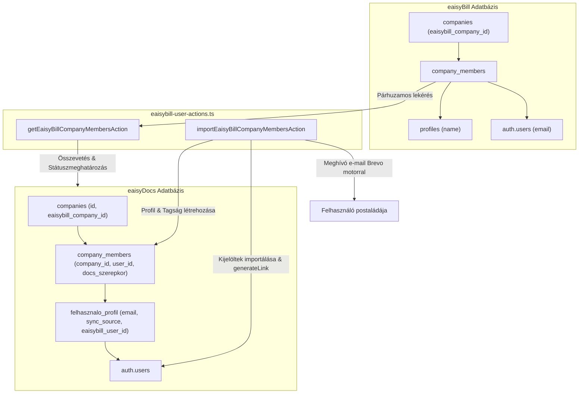

# ADR A-060: eaisyBill Cégalapú Felhasználó- és Tagságszinkronizáció, Szelektív Meghívó Rendszer

- **Státusz:** Elfogadva (Accepted)
- **Dátum:** 2026-10-14
- **Hatókör:** `[Közös]` eaisyDocs & eaisyBill Integráció (DOC-TASK-04)
- **Döntéshozók:** Termék- és Rendszerfejlesztési Csapat

---

## 1. Kontextus és Problémafelvetés
Az eaisyDocs és az eaisyBill két különálló Supabase adatbázisban él. A cég- és számlaimport (ADR [A-058](./A-058-eaisybill-company-import-and-sync.md)) megvalósítása után felmerült az igény a felhasználói állomány szinkronizációjára is (`DOC-TASK-04`).
Az eaisyBill-ben minden vállalkozáshoz (`companies`) külön tagok tartoznak a `company_members` kapcsolótáblán keresztül más-más szerepkörökkel (`owner`, `admin`, `member`, `assistant`, `viewer`, `employee`).
Korábban az eaisyDocs-ba történő cégátvételkor kizárólag az importáló tulajdonos került rögzítésre; a cég további munkatársait kézzel kellett volna egyenként felvenni, ami hibalehetőségeket és redundáns adminisztrációt eredményezett.

Emellett kiemelt biztonsági és adatvédelmi követelmény volt:
1. **Nincs vak automatizmus:** Tilos minden eaisyBill felhasználót válogatás nélkül átönteni és kéretlen e-mailekkel elárasztani.
2. **Kizárólag szelektív import és meghívás:** Kizárólag a kijelölt (bepipált) munkatársak kaphatnak eaisyDocs hozzáférést és meghívó e-mailt.
3. **Közös identitás, külön jogosultság:** Az e-mail cím képezi az egyedi azonosítót; a számlázási szerepköröket le kell képezni az eaisyDocs iratkezelési szerepköreire (`admin`, `vezeto`, `iktato`, `ugyintezo`, `betekinto`).

---

## 2. Architektúra és Megvalósítás

### 2.1 Adatbázis Bővítés (`felhasznalo_profil`)
A `felhasznalo_profil` táblát a `20261014000003_add_eaisybill_user_sync_columns.sql` migrációval felkészítettük:
- `email TEXT`: Indexelt mező a gyors azonosításhoz, amelyet az `auth.users`-ből szinkronizál egy automatikus adatbázis-trigger (`sync_felhasznalo_profil_email`).
- `eaisybill_user_id UUID`: Külső eaisyBill felhasználó ID nyilvántartása.
- `sync_source TEXT DEFAULT 'local'`: Adatforrás megjelölése (`local` vs. `eaisybill`).
- `last_synced_at TIMESTAMPTZ`: Legutóbbi szinkronizáció időbélyege.

### 2.2 Szerver Akciók (`src/app/actions/eaisybill-user-actions.ts`)
1. **`getEaisyBillCompanyMembersAction(companyId)`**:
   - Feloldja a céghez rendelt `eaisybill_company_id`-t.
   - Párhuzamosan lekéri az eaisyBill cégtagokat (`company_members`), neveiket (`profiles`) és e-mail címeiket (`auth.admin.getUserById`).
   - Összeveti az eaisyDocs helyi `company_members` és `felhasznalo_profil` tábláival.
   - Státuszokat allokál:
     - `already_member`: Már tagja az adott eaisyDocs cégnek.
     - `existing_user`: Már létezik eaisyDocs felhasználói fiókja, de ehhez a céghez még nincs hozzárendelve.
     - `new_user`: Új felhasználó, meghívó linket és regisztrációt igényel.
   - Javasolt iratkezelési szerepkört rendel mindenkihez.
2. **`importEaisyBillCompanyMembersAction(companyId, items)`**:
   - Szigorú jogosultsági ellenőrzés: csak a cég tulajdonosa (`owner`) vagy globális rendszergazda hívhatja meg.
   - **Csak és kizárólag a bepipált tételeken halad végig.**
   - Létező fióknál: `company_members` tagsági rekordot hoz létre a kiválasztott `docs_szerepkor`-ral, és frissíti az `elerheto_modulok` tömböt.
   - Új felhasználónál:
     - `supabaseAdmin.auth.admin.generateLink({ type: 'invite' })` hívással biztonságos jelszóbeállító linket generál.
     - Létrehozza a `felhasznalo_profil` és `company_members` bejegyzéseket.
     - A Brevo értesítő motoron (`sendNotificationEmail`) keresztül elegáns, márkázott e-mailt küld a jelszóbeállító gombbal.

### 2.3 Szerepkör Lefedés (Mapping)
- `owner`, `admin` ➔ `admin`
- `assistant` ➔ `iktato`
- `member`, `employee` ➔ `ugyintezo`
- `viewer` ➔ `betekinto`

---

## 3. Érintett Fájlok
- `supabase/migrations/20261014000003_add_eaisybill_user_sync_columns.sql`
- `scripts/apply-user-sync-migration.ts`
- `src/app/actions/eaisybill-user-actions.ts`
- `src/components/settings/eaisybill-member-import-dialog.tsx`
- `src/components/settings/company-settings-tab.tsx`

---

## 4. Hatások és Konzekvenciák
- **Biztonság & Spam-védelem:** Nincs tömeges kéretlen levélküldés; csak azok kapnak e-mailt, akiket a vezető explicit kijelöl.
- **Többcég-kezelés & GDPR:** A felhasználók cégtagságai teljesen szeparáltak maradnak a helyi `company_members` táblán.
- **Rugalmasság:** A számlázóban szereplő szerepkörök nem írják felül a dokumentumkezelési szinteket, az adminisztrátor személyenként dönthet a hatáskörről.
