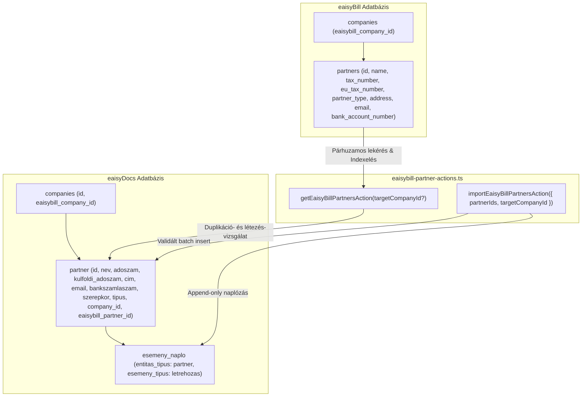

# ADR A-062: eaisyBill Partnertörzs Importálási Architektúra és Duplikáció-védett Szinkronizáció

- **Státusz:** Elfogadva (Accepted)
- **Dátum:** 2026-10-14
- **Hatókör:** `[Közös]` eaisyDocs & eaisyBill Integráció (Partnerek)
- **Döntéshozók:** Termék- és Rendszerfejlesztési Csapat

---

## 1. Kontextus és Problémafelvetés
Az eaisyBill platformon a vállalkozások számlázási, vevői és szállítói kapcsolattartása egy dedikált partnertörzsben (`partners` tábla) zajlik.
Az eaisyDocs rendszerben az iratkezelés és szerződéskezelés szintén elválaszthatatlan a partnerektől (`partner` tábla: bejövő és kimenő iratok címzettje/feladója, szerződések alanyai).

A felhasználók számára kiemelt nehézséget jelentett, hogy az eaisyBill-ben már gondosan felvitt cégadatokat (név, székhely, adószám, EU adószám, bankszámlaszám, e-mail cím) manuálisan újra be kellett volna gépelniük az eaisyDocs-ban.
A cél az volt, hogy:
1. Az aktív céghez (pl. `SANDBOX`) tartozó teljes eaisyBill partnertörzs egyetlen kattintással elérhető legyen a Partnerek nézetben.
2. A felhasználó szabadon választhasson: importálhat egyetlen kijelölt partnert, több partnert szűrve, vagy akár a komplett partnertörzset egyszerre.
3. Kettős és többszörös duplikáció-védelem biztosítsa, hogy egy már korábban rögzített partner ne jöjjön létre duplán (összevetés `eaisybill_partner_id`, adószám első 8 karaktere, EU adószám, valamint pontos név alapján).
4. Automatikus jogi forma és üzleti szerepkör felderítés működjön az importálás során.

---

## 2. Architektúra és Adatmodell

### 2.1 eaisyDocs Adatbázis Mezők
Az eaisyDocs `partner` táblája már tartalmazta a `eaisybill_partner_id UUID REFERENCES eaisybill.partners(id)` mezőt, amely közvetlen idegen kulcsként szolgál az eredeti rekordhoz.

### 2.2 Szerepkör és Jogi Forma Megfeleltetés
- **Szerepkör:**
  - `customer` -> `vevo`
  - `supplier` -> `szallito`
  - `both` -> `mindketto`
- **Jogi forma detektálás (`detectPartnerType`):**
  - Cégformák (`KFT`, `ZRT`, `NYRT`, `BT`, `GMBH`, `LTD`, stb.) -> `ceg`
  - Egyéni vállalkozói jelölések (`E.V.`, `EGYÉNI VÁLLALKOZÓ`) -> `egyeni_vallalkozo`
  - Állami / közigazgatási szervezetek (`MINISZTÉRIUM`, `HIVATAL`, `ÖNKORMÁNYZAT`, `NAV`) -> `intezmeny`
  - Alapértelmezés: `ceg`

### 2.3 Intelligens Adószámosztás
- Belföldi formátumú magyar adószámok (`12345678-x-yy`) az `adoszam` mezőbe kerülnek.
- Külföldi / EU formátumú vagy `FOREIGN:` prefixű azonosítók a `kulfoldi_adoszam` mezőbe kerülnek.

---

## 3. Duplikáció-védelem Algoritmusa
A `getEaisyBillPartnersAction` szerver akció az alábbi prioritási lánc szerint veti össze a helyi partnereket a forrás eaisyBill partnerekkel:
1. **Explicit ID egyezés:** `partner.eaisybill_partner_id === bp.id`
2. **Adószám törzsszám egyezés:** Az adószám első 8 számjegye pontosan egyezik.
3. **Külföldi / EU adószám egyezés:** Kis- és nagybetű független pontos egyezés.
4. **Partnernév egyezés:** Kis- és nagybetű független, trimmelt névegyezés.

Ha bármelyik feltétel teljesül, a partner állapota `already_imported` lesz, a felületen a checkbox inaktívvá (letiltottá) válik, zöld `Már importálva` jelvénnyel. Ezzel fizikailag megelőzhető a többszörös import.

---

## 4. Audit Naplózás és Tranzakciós Integritás
Az importálás lefutásakor az eaisyDocs szabályoknak megfelelően szigorúan **append-only** audit bejegyzés készül az `esemeny_naplo` táblába:
- `entitas_tipus`: `'partner'`
- `esemeny_tipus`: `'letrehozas'`
- `indoklas`: `X partner importálva eaisyBill partnertörzsből (Cégnév)`
- `user_id`: A műveletet végző bejelentkezett felhasználó ID-ja.

---

## 5. Kapcsolódó Döntések
- ADR [A-024](./A-024-partner-dual-classification-and-contacts-architecture.md): Partner kettős besorolás és kapcsolattartók
- ADR [A-029](./A-029-global-ui-consistency-and-unified-components.md): Rendszerszintű UI/UX egységesség és kanonikus komponensek
- ADR [A-058](./A-058-eaisybill-company-import-and-sync.md): eaisyBill cégimport és több-bérlős szinkronizáció
- ADR [A-060](./A-060-eaisybill-company-member-sync-and-invite.md): eaisyBill cégalapú tagságszinkronizáció
