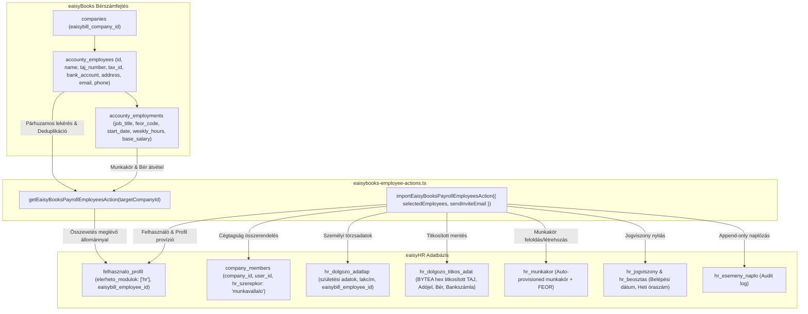

# ADR A-063: eaisyBooks Bérszámfejtés és eaisyHR Munkavállalói Import Architektúra

- **Státusz:** Elfogadva (Accepted)
- **Dátum:** 2026-10-15
- **Hatókör:** `[HR]` eaisyBooks Bérszámfejtés ➔ eaisyHR Integráció
- **Döntéshozók:** Termék- és Rendszerfejlesztési Csapat

---

## 1. Kontextus és Problémafelvetés
Az eaisyBooks platform bérszámfejtési alrendszerében (`accounty_employees` és `accounty_employments` táblák) a könyvelőirodák részletesen nyilvántartják a cégek (pl. *SANDBOX Kft.*) foglalkoztatottjait, beleértve a személyi azonosítókat, TAJ számot, adóazonosító jelet, bankszámlaszámot, alapbért, belépési dátumot és munkakört (FEOR kódokkal).

Az eaisyHR rendszerben az operatív humánerőforrás-gazdálkodáshoz (törzskarton, jelenléti ívek, szabadságok, beosztástervező, cafeteria, orvosi alkalmasság) ugyanezekre a dolgozói adatokra van szükség.
Korábban a HR munkatársnak vagy adminisztrátornak manuálisan, egyesével kellett volna újra felvennie a dolgozókat.

A cél az volt, hogy:
1. Az aktív vállalat eaisyBooks bérszámfejtésében tárolt dolgozói állománya egyetlen kattintással elérhető és szelektíven importálható legyen a HR Munkaasztalon (`/hr/admin`).
2. Biztosított legyen a többszörös duplikáció-védelem (`eaisybill_employee_id`, e-mail cím és cégtagság alapján).
3. A dolgozókhoz tartozó érzékeny adatok (TAJ, adójel, bankszámla, alapbér) automatikusan titkosított `BYTEA` formátumban kerüljenek a `hr_dolgozo_titkos_adat` táblába.
4. Ha a bérszámfejtésben megadott munkakör még nem létezik a cégnél, a rendszer automatikusan hozza létre a `hr_munkakor` katalógusban FEOR kóddal együtt.
5. A HR adminisztrátor közvetlenül a felületen megadhassa a hiányzó e-mail címeket, és egy kapcsolóval dönthessen arról, hogy küld-e aktivációs Brevo e-mailt a dolgozónak.

---

## 2. Architektúra és Adatmodell

---

## 3. Megvalósított Döntések és Szabályok

1. **Adatbázis szintű azonosító (`eaisybill_employee_id`):**
   - A `felhasznalo_profil` és a `hr_dolgozo_adatlap` táblák megkapták az `eaisybill_employee_id UUID` oszlopot és indexet.
   - Így a szinkronizáció azonnal észleli, ha egy dolgozó már korábban átvételre került, és `already_imported` státusszal letiltja az újbóli importálást.

2. **Érzékeny és Titkosított Adatok (GDPR / Mt. megfelelőség):**
   - A TAJ szám, adóazonosító jel, bankszámlaszám és alapbér SOHA nem tárolódik nyílt szöveges formában az eaisyHR-ben.
   - Az adatok a `toByteaHex` transzformációval kerülnek a `hr_dolgozo_titkos_adat` táblába, amely kizárólag a jogosult HR szerepkörök és RPC-k számára érhető el.

3. **Munkakör Dinamikus Provízió:**
   - Ha a cégnél már létezik az adott megnevezésű munkakör (pl. *"Marketing menedzser"*), a rendszer hozzárendeli.
   - Ha még nem létezik, automatikusan rögzíti a `hr_munkakor` táblában a megadott FEOR kóddal együtt.

4. **Szerkeszthető E-mail és Meghívó Vezérlés:**
   - Ha a dolgozónak nincs rögzített e-mail címe az eaisyBooks-ban, az importáló táblázatban helyben megadható.
   - A modál alsó sávjában a HR-es jelölőnégyzettel dönthet arról, hogy küld-e aktivációs Brevo e-mailt a dolgozóknak. Ha a jelölőnégyzet nincs bepipálva, a fiókok csendben létrejönnek a belső adminisztráció számára.

---

## 4. Érintett Fájlok
- `supabase/migrations/20261015000001_add_eaisybill_employee_id.sql`
- `src/app/hr/actions/eaisybooks-employee-actions.ts`
- `src/components/hr/eaisybooks-employee-import-dialog.tsx`
- `src/app/hr/admin/page.tsx`
